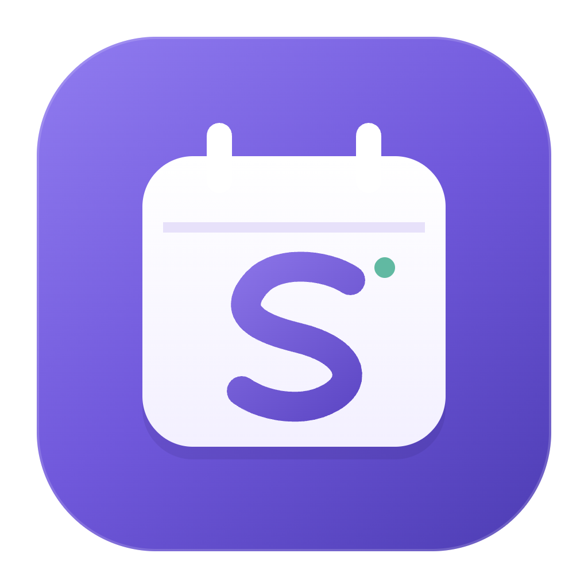
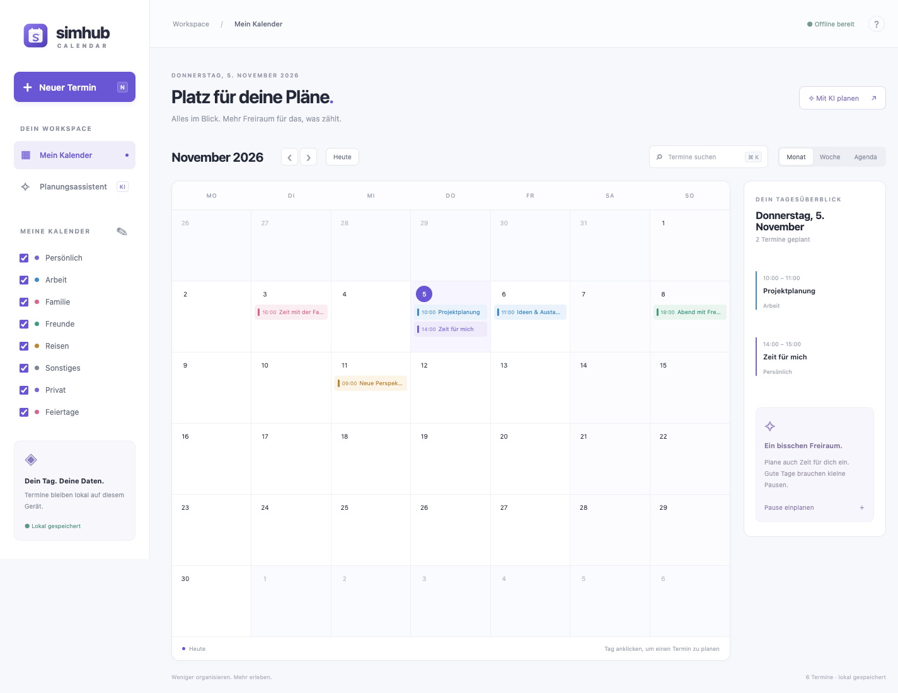

<p align="center">
  
</p>

# SimHub Calendar

Ein lokaler Desktop-Kalender mit deutscher Oberfläche, Monats-, Wochen- und Agendaansicht. Termine erstellen, bearbeiten, löschen, durchsuchen und nach Kalender filtern. Mit optionalem Planungsassistenten für lokale Modelle oder eine kompatible API.



*Die Abbildung zeigt Beispieldaten aus einem isolierten Testkalender.*

**Lokal gespeichert · Ohne Cloud-Zwang · Optionale KI · Offline nutzbar**

## Start

Voraussetzung: Node.js 22 oder neuer, npm und ein Desktop mit macOS, Windows oder Linux.

```sh
npm ci
npm start
```

Kein Webpack, keine CDN-Inhalte, keine Laufzeitbibliotheken im Renderer. Electron ist fest versioniert. Die bisherige Version 1.x wurde durch eine schlanke Version 2.x ersetzt; der alte Quellcode bleibt in der Git-Historie erhalten. Urheberhinweise und historische Contributor-Einträge bleiben erhalten und verleihen keine Repository-Rechte.

## Bedienung

- **Neuer Termin** oder **N** öffnet das Terminformular. Ein Klick auf einen Tag wählt dessen Datum.
- **Monat / Woche / Agenda** wechselt die Ansicht. Die Woche startet montags.
- Die Suche durchsucht Titel, Ort und Notizen über alle Termine und zeigt Ergebnisse als Liste. Kalenderfilter gelten auch für die Suche.
- Termine anklicken zum Bearbeiten. Überschneidungen im selben Kalender werden angezeigt.
- **✎** neben „Meine Kalender“ benennt Kalender um.
- **Einstellungen & Backup** exportiert und importiert JSON. Beim Import erfolgt eine Bestätigung und eine automatische Sicherung des bisherigen Datenbestands.
- **Synchronisation (CalDAV & Nextcloud):** Ermöglicht den sicheren Abgleich mit Nextcloud, Apple iCloud oder CalDAV-Servern.
- Ganztägige Termine verwenden ein exklusives Ende: Ein Tag beginnt um 00:00 und endet um 00:00 des Folgetags.
- **⌘/Strg K** fokussiert die Suche, **Esc** schließt Dialoge.

## Synchronisation (Nextcloud, Apple & CalDAV)

SimHub Calendar ist standardmäßig **100 % offline**. Wenn du Termine mit Familie, Partner oder Kollegen teilen oder auf mehreren Geräten nutzen möchtest, kannst du unter **Einstellungen & Backup → Synchronisation** einen CalDAV-Dienst einrichten:

- **Nextcloud / ownCloud:** Ideal für volle Datenhoheit (selbst gehostet oder europäische Provider wie Hetzner, mailbox.org). Die Server-URL ist der Kalender-Pfad aus der Nextcloud-Weboberfläche (z. B. `https://mein-nextcloud.de/remote.php/dav/calendars/benutzer/persoenlich/`).
- **Apple iCloud:** Unterstützt über Apples CalDAV-Endpunkt `https://caldav.icloud.com/` mit deiner Apple-ID und einem anwendungsspezifischen Passwort.
- **Beliebiger CalDAV-Server:** Kompatibel mit Radicale, Baïkal, Fastmail, Posteo oder Google Kalender.

### Sicherheit & Privatsphäre beim Sync
- **Keine Fremdbibliotheken:** Der CalDAV-Client nutzt ausschließlich Standard-HTTPS im isolierten Electron-Hauptprozess. Die Dateigröße der App wächst dadurch praktisch nicht (~8 KB).
- **Verschlüsselte Zugangsdaten:** Passwörter und App-Tokens werden über Electrons `safeStorage` im Schlüsselbund des Betriebssystems verschlüsselt in `sync-settings.json` gespeichert.
- **Offline-First:** Auch bei aktivierter Synchronisation bleibt der Kalender offline voll funktionsfähig. Über **„Verbindung testen“** und **„Jetzt synchronisieren“** behältst du jederzeit die volle Kontrolle über den Datenabgleich.

## KI & Agenten

Standardmäßig ist kein KI-Dienst aktiv. „Lokal vorbereiten“ ist eine regelbasierte Eingabehilfe ohne Modell und ohne Netzwerk. Erkannt werden `heute`, `morgen`, `übermorgen`, `YYYY-MM-DD`, `DD.MM.YYYY`, `um 14 Uhr`, `14:30` und numerische Dauern wie `45 Minuten`. Ohne Zeitangabe wird morgen 09:00 für eine Stunde vorbelegt. Immer prüfen: Diese Eingabehilfe ist kein vollständiger Sprachparser.

### Lokales Modell (Ollama)

Ollama separat installieren, starten und ein geeignetes Modell herunterladen. Unter **Einstellungen & Backup** den Anbieter **Ollama** und den installierten Modellnamen setzen. Alternativ im Terminal:

```sh
SIMHUB_AI_PROVIDER=ollama SIMHUB_AI_MODEL='DEIN_INSTALLIERTES_MODELL' npm start
```

Die App verwendet ausschließlich `http://127.0.0.1:11434/api/chat`. Es wird kein Modell automatisch installiert. Alternativ funktioniert auch `SIMHUB_OLLAMA_MODEL` als Kurzkonfiguration.

### Flexible API

Alternativ zur Einrichtung in den Einstellungen funktionieren die folgenden Umgebungsvariablen. Sie haben Vorrang vor gespeicherten Einstellungen.

Unterstützt wird das Chat-Completions-Format mit JSON-Ausgabe, beispielsweise bei OpenAI oder einem kompatiblen Anbieter. Modell und Schlüssel werden von dir gewählt. Am einfachsten richtest du die Verbindung unter **Einstellungen & Backup → Flexible KI-Anbindung** ein. Der Schlüssel wird mit Electrons `safeStorage` über das Betriebssystem verschlüsselt; ohne sichere Schlüsselablage wird die Speicherung verweigert. Deaktivieren löscht den gespeicherten Schlüssel. Bei geändertem Anbieter-Endpunkt muss der Schlüssel erneut eingegeben werden. Der Anbieter muss `response_format: {type: "json_object"}` unterstützen. Eine echte Anbieteranfrage wurde ohne deine Zugangsdaten nicht ausgeführt.

```sh
export SIMHUB_AI_PROVIDER=api
export SIMHUB_AI_MODEL='DEIN_MODELL'
export SIMHUB_AI_ENDPOINT='https://api.openai.com/v1/chat/completions'
read -s SIMHUB_AI_API_KEY
export SIMHUB_AI_API_KEY
npm start
unset SIMHUB_AI_API_KEY
```

Für andere Anbieter die vollständige HTTPS-Adresse zu `/chat/completions` setzen. Der Schlüssel aus der Umgebung wird nur vom Hauptprozess verwendet und nicht in Dateien gespeichert. Beim Einrichten über die Oberfläche wird der eingegebene Schlüssel an den Hauptprozess übergeben, dort verschlüsselt gespeichert und danach niemals wieder an die Oberfläche ausgegeben. Ein anderer Anbieter kann zusätzliche oder abweichende Parameter erfordern. `.env`-Dateien werden **nicht** automatisch geladen. Unter PowerShell die Variablen mit `$env:NAME = 'WERT'` setzen; Schlüssel nicht in die Shell-Historie schreiben.

Nur der eingegebene Text, Kalendernamen und aktuelles Datum/Zeitzone werden übertragen. Bestehende Termine werden nicht als Kontext übertragen. Anbieter können Kosten berechnen. Lokale Inferenz benötigt Rechenleistung, verursacht aber keine API-Kosten dieser App.

Der Assistent erzeugt einen validierten Entwurf. Er kann weder speichern noch löschen, Shellbefehle ausführen oder beliebige URLs öffnen. Erst **Speichern** übernimmt den Vorschlag. Die interne Agenten-Grenze ist `propose(prompt, calendars)` in `desktop/assistant.cjs` mit einem strukturierten Terminobjekt als Ergebnis; ein externer MCP-Server ist damit noch nicht enthalten. Für lokale Agenten gibt es eine JSON-CLI:

### Lokale Agenten-Schnittstelle

Die CLI liest eine einzelne JSON-Anfrage von stdin und schreibt eine JSON-Antwort nach stdout. Kein HTTP-Port, keine Shell-Werkzeuge, keine Schreibrechte auf Kalenderdaten. Für erfolgreiche Ergebnisse liefert stdout direkt das Objekt; Fehler stehen als JSON auf stderr mit Exitcode 1.

```sh
printf '%s' '{"tool":"capabilities"}' | node desktop/agent.cjs
printf '%s' '{"tool":"calendar.draft","mode":"local","text":"Morgen um 14 Uhr Projektbesprechung"}' | node desktop/agent.cjs > /tmp/termin-entwurf.json
```

Die Entwurfsdatei in **Einstellungen & Backup → Agenten-Entwurf öffnen** prüfen und anschließend speichern. `mode: "ai"` nutzt die oben beschriebenen Umgebungsvariablen, nicht den im Desktop-Schlüsselbund gespeicherten API-Schlüssel. `calendar.list` liest nur bei ausdrücklich gesetztem `SIMHUB_DATA_DIR` den lokalen Kalender. Mit gesetztem Datenordner verwenden Entwürfe dessen Kalendernamen und IDs. Entwürfe ohne Datenordner verwenden die Standardkalender.

Technische Quellen: [Electron-Sicherheit](https://www.electronjs.org/docs/latest/tutorial/security), [Ollama Chat API](https://docs.ollama.com/api/chat), [Chat Completions](https://developers.openai.com/api/reference/resources/chat/subresources/completions/methods/create).

## Daten & Migration

Daten liegen in `calendar-v2.json` unter Electrons `userData`-Verzeichnis. Auf macOS standardmäßig `~/Library/Application Support/Electron Calendar/`. Für einen eigenen oder portablen Datenordner kann `SIMHUB_DATA_DIR` auf einen absoluten Pfad gesetzt werden.

Beim ersten Start werden alte `storage/calendar.json` und Termin-JSONs aus demselben Ordner gelesen und validiert; Originale bleiben unangetastet. Bestehende Entwicklungsdaten der alten App können in einem separaten Ordner mit Zusatz `(development)` liegen. Sichere diesen Ordner vorab und verwende ihn explizit als Datenordner. Bei beschädigten oder nicht unterstützten Daten wird die Migration abgebrochen, nicht still überschrieben. Nicht unterstützte TUI-Zusatzfunktionen wie Wiederholungsregeln, Teilnehmer und Anhänge werden nicht in Version 2 übernommen; die alten Originaldateien bleiben dafür erhalten. Feiertage werden nicht automatisch geladen.

Backups enthalten persönliche Daten im Klartext. Betriebssystemkonto und Datenträgerverschlüsselung entsprechend schützen.

## Marke & App-Icons

Das neue Markenzeichen verbindet ein Kalenderblatt mit einem geschwungenen **S** und einem grünen Punkt als Tagesmarker. Es erscheint in der App, im Dock und in den installierten App-Paketen. Violett greift die Oberfläche auf; die Vektorquelle bleibt auch bei kleinen Größen scharf.

- Vektorquelle: [`ui/brand.svg`](ui/brand.svg)
- PNG-Master: [`resources/icon.png`](resources/icon.png), 1024 × 1024 Pixel mit transparentem Rand
- macOS: [`resources/icon.icns`](resources/icon.icns)
- Windows: [`resources/icon.ico`](resources/icon.ico)
- Linux: PNG-Größen von 16 bis 1024 Pixel unter [`resources/icons/`](resources/icons/)

Nach einer Änderung am SVG erzeugt `npm run icons` die Rasterdateien lokal mit dem bereits installierten Electron. Auf macOS wird zusätzlich ICNS über `iconutil` erstellt. Es werden keine Bilddienste angefragt und keine API-Gebühren ausgelöst. Anschließend `npm run pack` ausführen, damit die installierbare App das neue Icon enthält.

## Entwicklung & Prüfung

```sh
npm run check
npm test
npm run test:desktop
npm audit
npm run pack
```

- `desktop/`: Electron-Hauptprozess, Preload, validierte Speicherung, Eingabehilfe und KI-Adapter.
- `ui/`: HTML, CSS, Browser-JavaScript. Keine privilegierten APIs.
- `test/`: Tests für Datenvalidierung, persistente Speicherung, Migration und KI-Adapter.
- `docs/`: Sicherheits- und Zugriffsbericht.

Die gezielte `minimatch`-Override aktualisiert nur Versionen im gemeldeten verwundbaren Bereich. Vor Entfernen der Override Audit erneut prüfen. Legacy-Versionen anderer Major-Reihen werden nicht auf eine inkompatible API umgebogen.

## App bauen und weitergeben

| Befehl | Ergebnis |
| --- | --- |
| `npm start` | Startet die App aus dem Quellcode. |
| `npm run pack` | Erzeugt eine gebündelte, direkt startbare App unter `dist/`. |
| `npm run release` | Erzeugt zusätzlich ein Distributionspaket für die aktuelle Plattform, z. B. eine DMG auf macOS. |

Auf einem Mac mit Apple Silicon liegt die gebündelte App nach `npm run pack` unter `dist/mac-arm64/Electron Calendar.app`. Sie läuft eigenständig, ohne separat installiertes Node.js. Zum lokalen Verwenden ist kein zusätzlicher Release-Build erforderlich. Ein Build für Intel-Macs oder andere Betriebssysteme muss separat erstellt und geprüft werden.

Eine DMG erleichtert die Weitergabe. Für eine öffentliche macOS-Veröffentlichung sollten App und DMG mit einem gültigen Developer-ID-Zertifikat signiert und notarisiert werden. Ohne entsprechende Konfiguration bleiben lokale Builds unsigniert. Der Release-Befehl veröffentlicht nichts automatisch auf GitHub.

GitHub Actions ist in diesem Repository deaktiviert; Tests und Builds werden lokal ausgeführt. Die vorhandenen Workflows sind nur manuell startbar.
